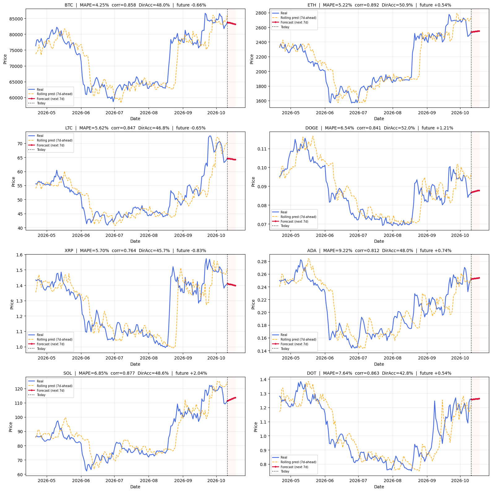

# Multi Coin Cryptocurrency Forecasting with LSTM

[](https://colab.research.google.com/github/<YOUR-USERNAME>/<YOUR-REPO>/blob/main/multi_coin_lstm_forecasting.ipynb)

One LSTM model, trained on several coins at once, predicts each coin's price **7 days ahead**. Each coin has
its own ID, so the model learns general patterns from all coins together while still giving each coin its
own prediction.

> This is a research project, not financial advice.



## What this project does

Training one model on several coins at once gives it more data to learn from, while each coin still gets its
own prediction through its own ID. Every result is checked against a simple baseline — "the price stays the
same" — so it's clear whether the model is actually useful, or just looks busy.

## How it works

- **What's predicted:** the price change (return) over the next 7 days, not the raw price. This is turned
 back into a price at the end.
- **Inputs:** price returns, RSI, and moving-average/MACD/Bollinger-Band indicators written as ratios to the
 current price, not as raw price — this keeps them in a similar range no matter how high or low a coin's
 price goes over time.
- **Model:** a shared Conv1D + LSTM + LSTM core, with each coin's ID feeding a small output layer of its own.
- **Data split:** 70% train / 15% validation / 15% test, in time order, done separately per coin so no future
 data leaks into training.
- **Checking the result:** test-set accuracy per coin against the "no change" baseline, plus a day-by-day
 rolling check over the last 180 days with the live forecast shown next to it.

**A note on reading the numbers:** the training `loss`/`mae` shown in the notebook are measured on the
return the model predicts, not on price — a small-looking training loss does not by itself mean the price
forecast is accurate. Always check the `Beats Naive?` and `Dir Acc %` columns in the test report.

## Data used

Daily price and volume data for BTC, ETH, LTC, DOGE, XRP, ADA, SOL, and DOT, from Binance's free public API
(no account or key needed). Data is downloaded when the notebook runs and is not stored in this repository.

## What you need

Python 3.10+ and the packages in `requirements.txt`. The notebook runs on the default Google Colab setup with
no extra installs; a GPU (Runtime → Change runtime type → T4 GPU) is recommended for faster training.

## How to run it

1. Click the **Open in Colab** badge above (replace `<YOUR-USERNAME>/<YOUR-REPO>` in the link first), or
  upload the notebook to Colab yourself.
2. Choose **Runtime → Run all**.
3. Tables and plots are saved into the `results/` folder.

## Results

From the run saved in this repository (`results/test_report.csv`, 7-day horizon, test set):

| Metric | Value |
|---|---|
| Coins that beat the simple baseline | 3/8 (LTC, DOGE, XRP) |
| Average model error (MAPE, test set) | 5.12% |
| Average baseline error (MAPE, test set) | 4.85% |
| Average directional accuracy | 50.7% (random guessing = 50%) |

**Honest read of this result:** the model does not reliably beat random guessing on direction, and it beats
the naive baseline on only 3 of 8 coins. The high correlation values (0.97–0.99) in the full table mostly
come from both lines drifting with the same price trend, not from the model calling direction correctly.
SOL's live forecast is the largest predicted move of any coin (+5.9% over 7 days) while also being the coin
with the worst test-set accuracy — treat that one with extra caution. See `results/test_report.csv` and the
notebook's Conclusion section for the full breakdown.

### Plots

| | |
|---|---|
|  |  |

## Known limits

- The raw price feature can still go outside its trained range during a strong, long trend.
- Only daily price and volume data is used — no news, sentiment, or on-chain data.
- The train/test split covers one period in time; results may look different in calmer or wilder markets.
- Price is much harder to predict than volatility. Treat directional accuracy with real caution.

## Project files

```text
├── multi_coin_lstm_forecasting.ipynb
├── README.md
├── requirements.txt
├── .gitignore
└── results/
   ├── test_report.csv
   ├── past_present_future.csv
   └── figures/
       ├── training_curves.png
       └── past_present_future.png
```
